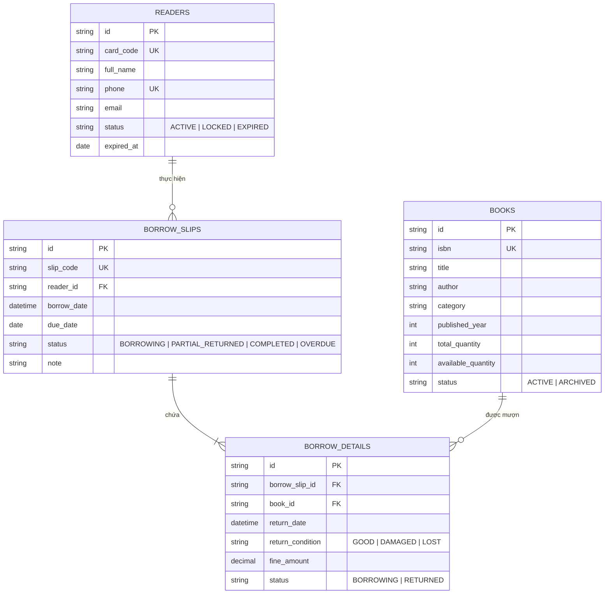
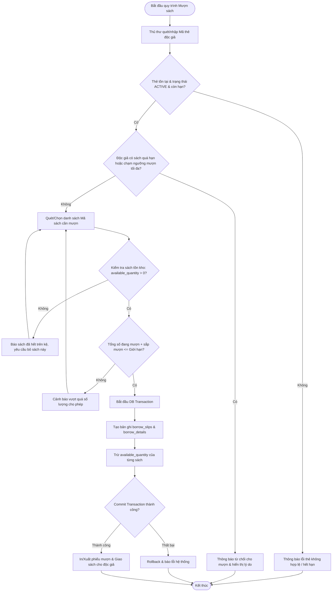
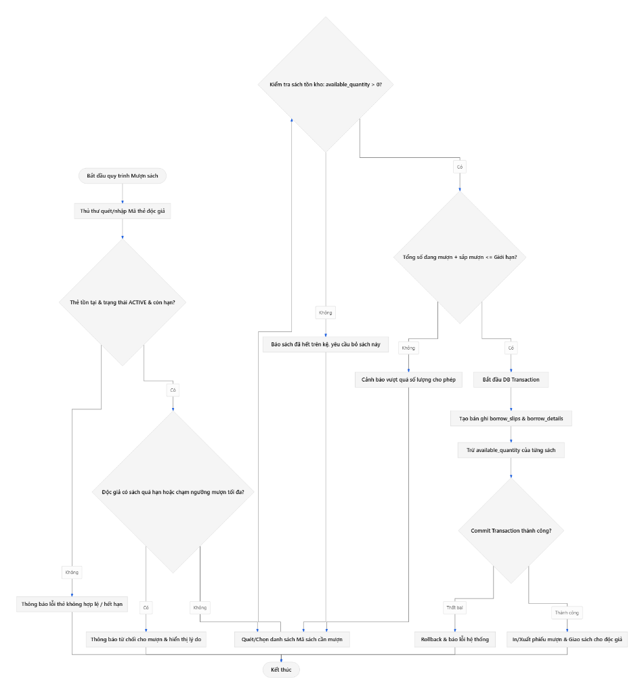
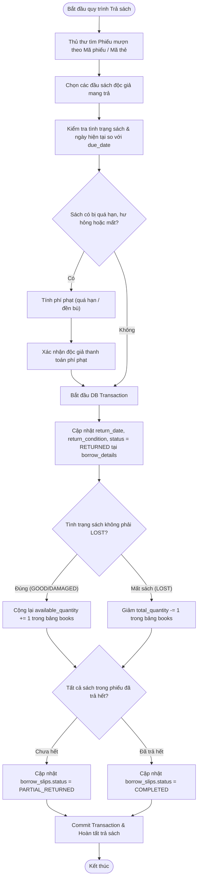

# BÁO CÁO BÀI THỰC HÀNH (LAB)
# PHÂN TÍCH, THIẾT KẾ VÀ XÂY DỰNG HỆ THỐNG QUẢN LÝ THƯ VIỆN ỨNG DỤNG CÔNG CỤ AI

* **Học phần:** Phát triển Ứng dụng / Công nghệ Phần mềm
* **Sinh viên thực hiện:** Trần Thị Ngọc Anh
* **Mã số sinh viên (MSSV):** 29209243814
* **Công cụ hỗ trợ AI:** Google AI Studio (Gemini), Antigravity IDE
* **Mô hình kiến trúc:** MVP (Minimum Viable Product) – Master/Detail Schema – Web SPA & LocalStorage

---

## PHẦN 1: TỔNG QUAN & KẾT QUẢ KHẢO SÁT VỚI GOOGLE AI STUDIO

Dưới góc độ kết hợp giữa **Business Analyst (BA)** và **Senior Developer**, phân tích dưới đây tập trung vào một hệ thống Quản lý Thư viện tinh gọn (MVP - Minimum Viable Product), đảm bảo đáp ứng đúng nghiệp vụ thực tế nhưng vẫn giữ kiến trúc dữ liệu chặt chẽ, dễ mở rộng và triệt tiêu các lỗi kỹ thuật phổ biến (như sai lệch tồn kho, race condition hay mất tính toàn vẹn dữ liệu).

### 1.1. Tác nhân chính tham gia hệ thống (Actors)
* **Thủ thư (Librarian):** Người trực tiếp vận hành hệ thống tại quầy (quản lý kho sách, cấp/khóa thẻ độc giả, thực hiện cho mượn/trả sách, xử lý hư hỏng, thu phí phạt).
* **Độc giả (Reader):** Đối tượng được quản lý thông tin mượn/trả, tra cứu sách và nhận thông báo nhắc hạn.

---

## PHẦN 2: PHÂN TÍCH NGHIỆP VỤ & QUY TẮC CỐT LÕI (BUSINESS RULES)

### 2.1. Các nhóm chức năng chính
1. **Quản lý Sách (Book Management):**
   * Thêm, sửa, ngừng lưu hành (`ARCHIVED` - soft delete) đầu sách.
   * Tìm kiếm, lọc sách theo tên, tác giả, ISBN, thể loại.
   * Theo dõi chính xác số lượng tổng (`total_quantity`) và số lượng khả dụng (`available_quantity`).
2. **Quản lý Độc giả (Reader Management):**
   * Đăng ký thẻ độc giả mới, cập nhật thông tin, gia hạn thẻ.
   * Khóa / mở khóa thẻ (`ACTIVE`, `LOCKED`, `EXPIRED`) khi độc giả vi phạm hoặc làm mất thẻ.
   * Xem lịch sử mượn/trả và trạng thái nợ sách của độc giả.
3. **Quản lý Mượn - Trả sách (Circulation Management):**
   * **Tạo phiếu mượn:** Kiểm tra điều kiện thẻ, kiểm tra tồn kho, tạo phiếu cho mượn 1 hoặc nhiều đầu sách cùng lúc.
   * **Ghi nhận trả sách:** Cho phép trả từng cuốn (Partial Return) hoặc trả toàn bộ phiếu; kiểm tra tình trạng sách (`GOOD` - tốt, `DAMAGED` - hư hỏng, `LOST` - mất); tính phí phạt nếu quá hạn hoặc đền bù.
   * **Gia hạn mượn:** Kéo dài hạn trả nếu sách chưa quá hạn.
4. **Cảnh báo & Thống kê cơ bản:**
   * Danh sách phiếu mượn sắp đến hạn hoặc đã quá hạn (`OVERDUE`).
   * Thống kê các đầu sách được mượn nhiều nhất và tình trạng kho.

### 2.2. Quy tắc nghiệp vụ cốt lõi (Business Rules)
* **BR-01:** Mỗi độc giả chỉ được mượn tối đa $N$ cuốn sách tại cùng một thời điểm (mặc định cấu hình: tối đa **5 cuốn**).
* **BR-02:** Thời hạn mượn mặc định là **14 ngày** tính từ ngày lập phiếu.
* **BR-03:** Độc giả đang bị khóa thẻ (`LOCKED`), hết hạn thẻ (`EXPIRED`), hoặc đang có sách quá hạn chưa trả thì **không được phép mượn thêm sách mới**.
* **BR-04:** Một phiếu mượn có thể chứa **nhiều đầu sách khác nhau**, và độc giả có thể **trả lẻ từng cuốn** trong phiếu đó vào các thời điểm khác nhau.

---

## PHẦN 3: THIẾT KẾ CẤU TRÚC DỮ LIỆU (DATABASE SCHEMA)

Để đáp ứng hoàn hảo quy tắc **BR-04** (một phiếu mượn có nhiều sách và có thể trả lẻ từng cuốn vào các ngày khác nhau), mô hình cơ sở dữ liệu được chuẩn hóa tách thành quan hệ **Master - Detail**: `borrow_slips` (Master) và `borrow_details` (Detail).



### A. Bảng `books` (Sách)
| Tên trường | Kiểu dữ liệu | Ràng buộc | Mô tả |
| :--- | :--- | :--- | :--- |
| `id` | VARCHAR / UUID | PK | Định danh duy nhất của đầu sách |
| `isbn` | VARCHAR(20) | UNIQUE, NOT NULL | Mã số chuẩn quốc tế / mã quản lý nội bộ |
| `title` | VARCHAR(255) | NOT NULL | Tên tác phẩm / sách |
| `author` | VARCHAR(150) | NOT NULL | Tên tác giả |
| `category` | VARCHAR(100) | | Thể loại sách (CNTT, AI, Kinh tế, ...) |
| `published_year` | INT | | Năm xuất bản |
| `total_quantity` | INT | NOT NULL, $\ge 0$ | Tổng số bản sách thư viện sở hữu |
| `available_quantity`| INT | NOT NULL, $\ge 0$ | Số bản còn trên kệ có thể cho mượn |
| `status` | ENUM | NOT NULL | `ACTIVE` (đang lưu hành), `ARCHIVED` (ngừng lưu hành) |
| `created_at` | TIMESTAMP | DEFAULT NOW() | Thời điểm tạo |

### B. Bảng `readers` (Độc giả)
| Tên trường | Kiểu dữ liệu | Ràng buộc | Mô tả |
| :--- | :--- | :--- | :--- |
| `id` | VARCHAR / UUID | PK | Định danh độc giả |
| `card_code` | VARCHAR(20) | UNIQUE, NOT NULL | Mã thẻ độc giả (dùng để quét mã vạch/QR) |
| `full_name` | VARCHAR(150) | NOT NULL | Họ và tên |
| `phone` | VARCHAR(15) | UNIQUE, NOT NULL | Số điện thoại liên hệ |
| `email` | VARCHAR(150) | | Email nhận thông báo nhắc hạn |
| `status` | ENUM | NOT NULL | `ACTIVE`, `LOCKED`, `EXPIRED` |
| `expired_at` | DATE | NOT NULL | Ngày hết hạn thẻ |
| `created_at` | TIMESTAMP | DEFAULT NOW() | Ngày cấp thẻ |

### C. Bảng `borrow_slips` (Phiếu mượn - Header)
| Tên trường | Kiểu dữ liệu | Ràng buộc | Mô tả |
| :--- | :--- | :--- | :--- |
| `id` | VARCHAR / UUID | PK | Định danh phiếu mượn |
| `slip_code` | VARCHAR(20) | UNIQUE, NOT NULL | Mã phiếu hiển thị (VD: `PM-20261123-001`) |
| `reader_id` | VARCHAR / UUID | FK $\rightarrow$ `readers.id` | Độc giả thực hiện mượn |
| `borrow_date` | DATETIME | NOT NULL | Thời điểm lập phiếu |
| `due_date` | DATE | NOT NULL | Hạn trả dự kiến |
| `status` | ENUM | NOT NULL | `BORROWING`, `PARTIAL_RETURNED`, `COMPLETED`, `OVERDUE` |
| `note` | TEXT | | Ghi chú của thủ thư |

### D. Bảng `borrow_details` (Chi tiết Phiếu mượn)
| Tên trường | Kiểu dữ liệu | Ràng buộc | Mô tả |
| :--- | :--- | :--- | :--- |
| `id` | VARCHAR / UUID | PK | Định danh dòng chi tiết |
| `borrow_slip_id` | VARCHAR / UUID | FK $\rightarrow$ `borrow_slips.id` | Thuộc phiếu mượn nào |
| `book_id` | VARCHAR / UUID | FK $\rightarrow$ `books.id` | Cuốn sách được mượn |
| `return_date` | DATETIME | NULL | Ngày trả thực tế (`NULL` nếu chưa trả) |
| `return_condition` | ENUM | NULL | `GOOD` (tốt), `DAMAGED` (hư hỏng), `LOST` (mất) |
| `fine_amount` | DECIMAL(10,2) | DEFAULT 0 | Tiền phạt (quá hạn / đền bù hư hỏng) |
| `status` | ENUM | NOT NULL | `BORROWING`, `RETURNED` |

---

## PHẦN 4: SƠ ĐỒ QUY TRÌNH NGHIỆP VỤ MƯỢN / TRẢ (MERMAID & MINH CHỨNG AI)

### 4.1. Quy trình 1: Mượn sách (Borrow Flow)



#### Minh chứng ảnh sơ đồ Mượn sách từ Google AI Studio:


---

### 4.2. Quy trình 2: Trả sách (Return Flow)



#### Minh chứng ảnh sơ đồ Trả sách từ Google AI Studio:


---

## PHẦN 5: LƯU Ý KỸ THUẬT TỪ SENIOR DEVELOPER KHI TRIỂN KHAI

1. **Chống sai lệch tồn kho (Race Condition):**
   Khi có 2 thủ thư thao tác cho mượn cùng một đầu sách chỉ còn 1 cuốn cuối cùng (`available_quantity = 1`), không nên kiểm tra số lượng ở tầng Application rồi mới Update. Thay vào đó, bọc trong Transaction và dùng câu lệnh **Atomic Update** ở tầng Database:
   ```sql
   UPDATE books 
   SET available_quantity = available_quantity - 1 
   WHERE id = :book_id AND available_quantity > 0;
   ```
   Nếu số dòng bị ảnh hưởng (`affected_rows`) bằng 0, hệ thống lập tức rollback và thông báo hết sách.

2. **Tối ưu truy vấn (Indexing):**
   * Đánh **B-Tree Index** cho `readers.card_code`, `books.isbn`, `borrow_slips.slip_code` để phục vụ quét mã vạch/QR tức thì ($O(1)$ lookup).
   * Tạo **Composite Index** `(status, due_date)` trên bảng `borrow_slips` để phục vụ Cronjob quét nhanh các phiếu quá hạn mỗi đêm mà không cần Full Table Scan.

3. **Xử lý trạng thái Quá hạn (OVERDUE):**
   Không nên tính trạng thái quá hạn thụ động dựa vào thao tác người dùng. Thiết lập **Scheduled Job (Cronjob)** chạy định kỳ (00:05 mỗi ngày) quét các phiếu có `status IN ('BORROWING', 'PARTIAL_RETURNED')` và `due_date < CURRENT_DATE` để cập nhật sang `OVERDUE`, đồng thời tự động kích hoạt tiến trình gửi email cảnh báo đến độc giả.

---

## PHẦN 6: KẾT QUẢ KIỂM THỬ THỰC TẾ TRÊN ỨNG DỤNG

| Mã TC | Tình huống kiểm thử | Hành động thực hiện | Kết quả thực tế | Trạng thái |
| :--- | :--- | :--- | :--- | :--- |
| **TC01** | Kiểm tra BR-03 (Thẻ bị khóa) | Chọn độc giả `DG003` (Trạng thái `LOCKED`) mượn sách. | Hệ thống từ chối lập phiếu, thông báo thẻ đang bị khóa. | **PASS** |
| **TC02** | Kiểm tra BR-03 (Thẻ hết hạn) | Thử mượn với độc giả có `expired_at < CURRENT_DATE`. | Hệ thống từ chối mượn sách, yêu cầu gia hạn thẻ. | **PASS** |
| **TC03** | Kiểm tra BR-01 (Giới hạn tối đa) | Chọn mượn vượt quá 5 cuốn (hoặc tổng đang mượn + sắp mượn > 5). | Cảnh báo vượt quá ngưỡng 5 cuốn theo quy định BR-01. | **PASS** |
| **TC04** | Kiểm tra mượn nhiều sách | Chọn cùng lúc 2 đầu sách khác nhau trong 1 phiếu mượn. | Tạo thành công 1 `borrow_slips` và 2 bản ghi `borrow_details`. | **PASS** |
| **TC05** | Kiểm tra BR-04 (Trả lẻ từng cuốn) | Trả 1 trong 2 cuốn trong phiếu mượn. | Phiếu chuyển sang `PARTIAL_RETURNED`, cuốn đã trả tăng lại tồn kho. | **PASS** |
| **TC06** | Xử lý sách bị mất (`LOST`) | Chọn tình trạng trả sách là `LOST`. | Không cộng lại `available_quantity`, giảm `total_quantity` đi 1 và tính phí đền bù. | **PASS** |
| **TC07** | Tra cứu AI Assistant | Hỏi: *"Gợi ý sách về Trí tuệ nhân tạo và Machine Learning"*. | AI đề xuất chính xác các sách thuộc thể loại AI kèm trạng thái còn/hết sách. | **PASS** |
